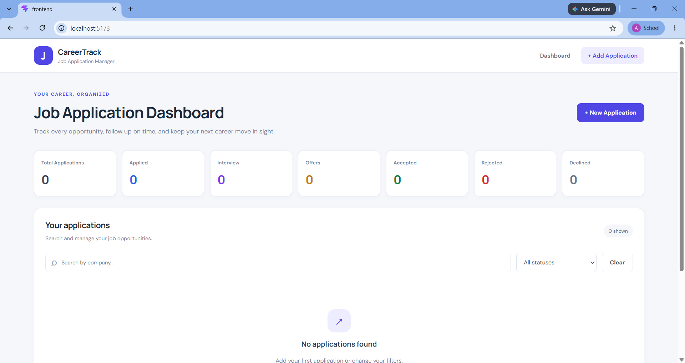
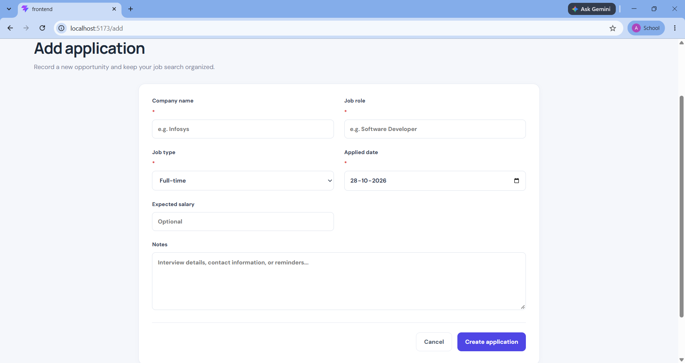

## Running the Project

### Backend
1. Open a terminal in the `backend` directory.
2. Install dependencies using `npm.cmd install`.
3. Start the server using `npm.cmd run dev`.

### Frontend
1. Open a separate terminal in the `frontend` directory.
2. Install dependencies using `npm.cmd install`.
3. Start the development server using `npm.cmd run dev`.
4. Open the local URL displayed in the terminal.

### Environment Configuration
Configure the required environment variables in the `.env` files before running the application. Use valid MongoDB Atlas settings for the backend database connection.
## Screenshots

### Dashboard

### Application Form
